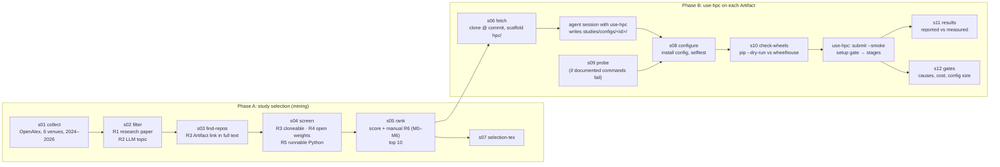

# use-hpc-eval

**The evaluation harness for [`use-hpc`](https://github.com/ai4se4ai-lab/use-hpc-claude-skill), an agent skill that turns the experiments of a paper into a checked graph of Slurm jobs.**

`use-hpc` lets a coding agent (Claude Code) *propose* an experiment graph, while fixed programs *decide* what runs: a validator, in-job guards, a setup gate, a smoke run and a live audit. This repository holds the scripts and data we used to evaluate that design and to test it on Artifacts of published software engineering papers. 

The harness does three things, and you can reuse each one on its own:

1. **Mine a reproducible sample of studies** from top SE venues: papers → LLM topic → linked GitHub Artifact → open-weight models → runnable → feasible on one cluster. Every criterion is in one file and every decision is logged.
2. **Apply `use-hpc` to each selected Artifact**: clone it at a fixed commit, scaffold `hpc/`, install the agent-written configuration, pre-check the wheels, then run setup gates and smoke runs, and compare the measured numbers with the reported ones.
3. **Measure benefit and cost** from Slurm accounting (`sacct`), step ledgers and GPU samples. No number is copied by hand: every LaTeX table is generated from the CSVs.

It needs only the Python standard library. The offline steps run in seconds on a laptop or a login node.

---

## Contents

- [Quick start](#quick-start)
- [Repository layout](#repository-layout)
- [Evaluation design](#evaluation-design)
- [Workflow](#workflow)
  - [Phase A: study selection](#phase-a-study-selection-s01s05-s07)
  - [Phase B: applying use-hpc to the Artifacts](#phase-b-applying-use-hpc-to-the-artifacts-s06-s08s12)
  - [Pilot: benefit and cost](#pilot-benefit-and-cost-rq1rq2)
- [The ten selected Artifacts](#the-ten-selected-artifacts)
- [Reproducing the papers' numbers](#reproducing-the-papers-numbers)
- [Running the full pipeline](#running-the-full-pipeline)
- [Configuration](#configuration)
- [Data files](#data-files)
- [Extending the evaluation](#extending-the-evaluation)
- [Status and limitations](#status-and-limitations)
- [Citing](#citing)

---

## Quick start

```bash
git clone <this repository> use-hpc-eval && cd use-hpc-eval

# No installation needed: check that every committed table regenerates byte for byte (offline, seconds)
make check
```

`make check` runs the unit tests. It then reruns the offline steps on a temporary copy of `data/` (topic filter, ranking, selection tables, study gates) and compares each output with the committed file:

```
ran  filter
ran  rank
ran  selection-tex
ran  gates
ok   data/funnel.csv
ok   data/selected.csv
...
all regenerated files match
```

To get the `use-hpc-eval` command, install the package into a virtual environment. On Digital Research Alliance clusters, use the wheelhouse:

```bash
module load python/3.11
virtualenv --no-download .venv && source .venv/bin/activate
pip install --no-index -e .          # elsewhere: pip install -e .

use-hpc-eval list                    # every step, its number, and what it needs
use-hpc-eval paths                   # where data, configurations and work files are
```

Without installing, `PYTHONPATH=src python3 -m use_hpc_eval <command>` does the same.

To *apply* the evaluation to new Artifacts, you also need the skill itself:

```bash
claude plugin marketplace add ai4se4ai-lab/use-hpc-claude-skill \
  && claude plugin install use-hpc@ai4se4ai-hpc
```

---

## Repository layout

```
use-hpc-eval/
├── src/use_hpc_eval/            the harness (stdlib only)
│   ├── cli.py                   `use-hpc-eval <command>`: one entry point for every step
│   ├── config.py                paths and EVERY selection criterion (venues, regexes, budgets)
│   ├── selection/               Phase A: s01–s05, s07, plus triage helpers for the manual round
│   ├── study/                   Phase B: s06, s08–s12
│   └── pilot/analyze_pilot.py   RQ1–RQ2: aggregates the pilot's ledgers and sacct dump
├── studies/
│   ├── configs/<owner__repo>/   per-Artifact use-hpc configuration written by the agent:
│   │                            experiments.json, requirements.txt, reported.csv, compare.py,
│   │                            optional hooks/ and glue_*.py
│   ├── probes/<id>.json         probe specifications for Artifacts that cannot run as documented
│   └── common/                  compare_lib.py (reported-vs-measured), ollama.sh, vllm.sh hooks
├── data/                        committed evidence; every paper table is generated from it
│   ├── papers.jsonl …           selection inputs and outputs (see "Data files")
│   ├── decisions.csv            one row per paper per round: kept or dropped, and why
│   ├── manual_screening.csv     the human decisions of round 6 (M0–M6)
│   ├── selected.csv             the 10 Artifacts, with their screened commit
│   ├── reproduction_plan.csv    mode (full or probe), models and comparison target per Artifact
│   ├── study_log.md             chronological log of decisions, defects and deviations
│   ├── results/                 study jobs, runs and configuration size (CSV)
│   ├── tex/                     generated LaTeX tables and figure data (\input by the papers)
│   └── pilot/                   sacct dump and derived CSVs of the 44,352-run pilot
├── docs/msr/, docs/emse/        the two papers (LaTeX + BibTeX)
├── scripts/
│   ├── verify_offline.py        `make check`: regenerate and diff
│   └── chain_screen.sh          runs network rounds s03 → s04 → s05 in sequence
├── tests/                       unittest suite (offline)
├── Makefile, pyproject.toml, .gitignore
```

Large, machine-specific files (full texts of PDFs, clones, run directories, model caches) never go into git. They live under `$REPRO_WORK`, which defaults to `$SCRATCH/use-hpc-eval`.

---

## Evaluation design

| RQ (MSR paper) | Question | Evidence | Command |
|---|---|---|---|
| **RQ1 — benefit** | Which failures are caught early? How much parallelism is gained? What does the tool reveal that the scheduler does not? | Pilot: 188 jobs in 11 submissions, ledgers, GPU samples. RQ3 gates. | `pilot`, `gates` |
| **RQ2 — cost** | What do the machinery and its configuration cost? | Timing of the template on the login node, smoke-run GPU time, configuration lines | `pilot`, `gates` |
| **RQ3 — reuse** | How does the agent fare on published Artifacts it has never seen? | 10 Artifacts mined from 4,814 SE papers; setup gates, configuration size, defects found | `collect` … `results` |

In the EMSE version, the pilot questions are split into RQ1 (expressiveness), RQ2 (safety), RQ3 (efficiency) and RQ4 (observability and overhead). Its RQ5 (generality) is the Artifact study of this repository.

**Two subjects, two roles.** The pilot's graph was written by the template's authors, so RQ1–RQ2 test the *template*. In RQ3, a fresh Claude Code session wrote each Artifact's configuration, so RQ3 tests the *agent*.

---

## Workflow



### Phase A: study selection (s01–s05, s07)

The goal is an **unbiased, auditable sample** of recent SE papers whose Artifacts *could* be rerun with open-weight LLMs on one academic cluster. Every criterion is defined in [config.py](src/use_hpc_eval/config.py). Every automatic decision is written to [data/decisions.csv](data/decisions.csv), and every manual one to [data/manual_screening.csv](data/manual_screening.csv).

| Round | Criterion | Step | Remaining |
|---|---|---|---:|
| 0 | All publications of **ICSE, FSE, ASE, TSE, EMSE, TOSEM**, 2024–2026 (OpenAlex) | `collect` (s01) | 4,814 |
| 1 | Research papers: no front matter, keynotes, errata; at least 8 pages when known | `filter` (s02) | 4,187 |
| 2 | LLM topic in title or abstract (`LLM_TOPIC` regex) | `filter` (s02) | 1,574 |
| 3 | Paper links a GitHub Artifact in its **full text** | `find-repos` (s03) | 584 papers |
| 3b | Distinct repositories | | 569 |
| 3c | Reachable and cloneable (`git ls-remote`, shallow clone) | `screen` (s04) | 474 |
| 4 | Uses **open-weight** models (code, configs or README); not proprietary-API only | `screen` (s04) | 310 |
| 5 | Python, dependency file, README run commands, last commit after 2023-06 | `screen` (s04) | 118 |
| 6 | Manual feasibility M0–M6, screened in rank order until 10 pass (24 decisions) | `rank` (s05) | **10** |

**How each round works**

- **s01 collect.** DBLP's automated access was behind bot protection at the time of the study, so the harness pages through **OpenAlex** (CC0, polite pool). Venue source IDs are in `config.VENUES`; FSE is the FSE issue of PACMSE. Abstracts are rebuilt from OpenAlex's inverted index. The step is resumable.
- **s02 filter.** Round 1 uses a title pattern and a page count. Round 2 uses `LLM_TOPIC`, a regex over generic terms (LLM, language model, foundation model) and model families (GPT, Llama, Qwen, StarCoder, DeepSeek, …).
- **s03 find-repos.** Abstract links are often missing, so for each paper the step fetches the full text from arXiv (found through Semantic Scholar or an exact title search) or from an open-access PDF, converts it with `pdftotext`, and scores every `github.com/<owner>/<repo>` link. Links in a data-availability or replication section, or next to words like *artifact*, *our code* or *replication package*, score high. Links to frameworks and model vendors (`NOT_ARTEFACT_OWNERS`) are ignored. arXiv's limit of one request per 3 s is respected.
- **s04 screen.** Each candidate is shallow-cloned without blobs over 200 KB, so only code is fetched, never data or weights. A clone that fails a round is deleted right away to protect scratch quota and file counts. Open-weight usage (`OPEN_WEIGHT`), proprietary APIs (`PROPRIETARY`), Ollama, language, dependency files, README commands and last-commit date are recorded in `r4_repos.jsonl`.
- **s05 rank.** The repositories that pass are ordered by a fixed, deterministic score that favours what makes a rerun on a cluster feasible:

  ```
  score = 10·[uses Ollama] + 2·log2(1 + open-weight mentions) + min(README run commands, 5)
        + 2·[last commit ≥ 2025] + 1·[licence file] − 2·[also calls proprietary APIs]
  ```

  A human then screens them **in rank order** against M0–M6 and records the first criterion that fails:

  | | Manual criterion (round 6) |
  |---|---|
  | M0 | The repository is the paper's own Artifact, not a third-party tool it used |
  | M1 | The paper reports quantitative results of an open-weight-model experiment that the repository runs |
  | M2 | That experiment has a documented entry point (and needs no Docker, which the cluster lacks) |
  | M3 | Its data and benchmarks are public |
  | M4 | Its models are open-weight, available, and at most **34B** parameters (one 80 GB H100) |
  | M5 | The reproduced subset fits **300 H100-hours** |
  | M6 | No human participants or paid services |

  Screening stops once 10 repositories pass. `triage` and `paper-text` print the facts a screener needs (model sizes, Docker use, data hosts, README commands, shipped results, matching lines of the paper).
- **s07 selection-tex** writes the funnel, exclusion, venue and selection tables that the papers `\input`.

All deviations from the plan are logged in [data/study_log.md](data/study_log.md). For example, an s03 bug that dropped hyphens at line breaks inside URLs was fixed, and all 1,574 papers were rescanned; the buggy output is kept for audit.

### Phase B: applying use-hpc to the Artifacts (s06, s08–s12)

| Step | Command | What happens |
|---|---|---|
| s06 | `use-hpc-eval fetch` | Full clone of each selected Artifact **at the commit that was screened**, then `scaffold.sh` of the skill creates `<clone>/hpc/` |
| — | *agent session* | A **new** Claude Code session with `use-hpc` reads the paper and the repository and writes the configuration. It may not edit the Artifact or the template. The files are copied to `studies/configs/<id>/` |
| s09 | `use-hpc-eval probe <id> studies/probes/<id>.json` | Used when the agent reports blocking defects in the documented commands. It generates a **probe** graph that runs every README entry point once at minimal size, so an exit code can confirm the defect |
| s08 | `use-hpc-eval configure [id …]` | Installs the configuration into the clone and generates `cluster.env` (account, modules, scratch paths, wheel directory, model-server hooks). `bash hpc/scripts/selftest.sh` must then pass |
| s10 | `use-hpc-eval check-wheels [id …]` | `pip install --dry-run --no-index` in a throw-away venv: requirements are checked against the Alliance wheelhouse **before** any job is queued |
| — | `python3 hpc/slurm/submit.py --smoke` (in the clone) | The use-hpc pipeline: a setup **gate** runs first, and Slurm cancels every `afterok` dependent if it fails. Watch it with `bash hpc/status.sh --watch 120` |
| s11 | `use-hpc-eval results` | Per Artifact, joins `reported.csv` with the run's `measured.csv` and classifies the outcome (below). Cost comes from one `sacct` call |
| s12 | `use-hpc-eval gates [--refresh]` | Gates in submission order, failure causes, cancelled dependents, H100-equivalent hours (a MIG slice counts by its compute share, 1g = 1/7), configuration lines. Without `--refresh`, it rebuilds the tables from the committed CSV |

**Two modes per Artifact.** In **full** mode, the paper's reported subset is rerun and compared. In **probe** mode, each documented entry point runs once, so that a defect found while configuring is confirmed by execution rather than claimed. Where an Artifact ships raw outputs, the configuration first **re-scores** them, to separate errors in the metric code from differences in the rerun.

**Comparison rules** ([studies/common/compare_lib.py](studies/common/compare_lib.py)). `reported.csv` holds one row per number the paper reports for the subset: key, metric, value, tolerance, source table or page, and whether it is comparable. Each row ends in one of these statuses:

| Status | Rule |
|---|---|
| `reproduced` | \|measured − reported\| ≤ tolerance (the paper's own variance where stated, else 2 points for percentages, 0.02 for fractions, 5 % relative otherwise) |
| `deviates` | measured, but outside the tolerance |
| `missing` | comparable, but the run produced no value |
| `not_comparable` | the Artifact cannot produce this number (reason kept, e.g. "evaluation code missing") |

Per Artifact, `s11` then assigns one outcome: **NR** (not runnable as released), **NC** (not comparable), **R** (reproduced), **P** (partially reproduced), or **D** (deviates).

### Pilot: benefit and cost (RQ1–RQ2)

The pilot is a real code-generation study: 8 conditions × 7 open-weight models (7B–32B) × 264 tasks (HumanEval+ and ClassEval) × 3 seeds = **44,352 runs**, plus side studies. That is 26 jobs and 122 steps per submission on Nibi H100s. `use-hpc-eval pilot --logs <pilot>/hpc/logs` reads the step ledgers, GPU samples and [data/pilot/sacct_raw.psv](data/pilot/sacct_raw.psv) (one `sacct -X -P` dump of all 188 jobs). It writes:

| File | Content | Used for |
|---|---|---|
| `runs.csv` | per submission: jobs by state, steps ok or failed, nodes, makespan, summed job time, concurrency, GPU-hours, queue waits | gate cancellations, concurrency 2.0–2.7× |
| `stages_smoke.csv` | step seconds per stage of each smoke run | critical path |
| `gpu_util.csv` | samples, mean utilisation and busy share per job | the two silently idle GPU jobs (2–5 %) |
| `summary.json` | headline numbers and the snapshot time | text of RQ1 |
| `microbench.csv` | login-node timings of scaffold, self-test, runner, audit and collector | RQ2 |

The raw ledgers belong to the pilot project and are not in this repository. The derived CSVs are. Pass `--snapshot "2026-10-13 13:03:45"` to regenerate the published numbers exactly; a clone does not keep the sacct dump's mtime, which is otherwise used as the snapshot time.

---

## The ten selected Artifacts

| ID | Artifact | Venue | Mode | Models | Executed subset |
|---|---|---|---|---|---|
| R1 | [wwwql/semguard](studies/configs/wwwql__semguard) | ASE'25 | probe | StarCoder2-7B, DeepSeek-Coder-1.3B | every README entry point |
| R2 | [cmu-soda/provenanceguard](studies/configs/cmu-soda__provenanceguard) | ASE'26 | full | Qwen3.5-9B (vLLM) | 3 methods × 2 benchmarks × 5 runs; re-score of shipped runs |
| R3 | [isenglab/retrigen](studies/configs/isenglab__retrigen) | TOSEM'25 | full | CodeLlama-7B (Ollama), CodeT5-base | retrieval and 75-epoch fine-tuning on both datasets |
| R4 | [moyi-dong/execre](studies/configs/moyi-dong__execre) | ASE'26 | full | Qwen2.5-Coder-32B, Llama-3.1-8B (vLLM) | Base / TextGrad / ExeCRE on LiveCodeBench |
| R5 | [yyyy-yuyu/effiskel](studies/configs/yyyy-yuyu__effiskel) | FSE'26 | probe | DeepSeek-Coder-6.7B | every README entry point |
| R6 | [anonauthors123/llm-for-binary-spd](studies/configs/anonauthors123__llm-for-binary-spd) | TOSEM'26 | full | Qwen2.5-Coder-7B (vLLM) | zero-shot on pseudo-code and assembly; re-score |
| R7 | [libolun-star/ircoco](studies/configs/libolun-star__ircoco) | FSE'24 | probe | GPT-2 / CodeGPT | every README entry point |
| R8 | [frabbisw/robustextended](studies/configs/frabbisw__robustextended) | EMSE'26 | full | CodeGen-2B, Qwen2.5-Coder-7B | nominal, partial and 6 format perturbations × 5 seeds |
| R9 | [klsc749/llm4perf](studies/configs/klsc749__llm4perf) | ICSE'26 | full | Qwen2.5-7B/32B (Ollama) | sampler on 4 systems |
| R10 | [leaperovo/logreasoner](studies/configs/leaperovo__logreasoner) | TOSEM'26 | probe | Llama-3-8B | every README entry point |

The commit of each Artifact is in [data/selected.csv](data/selected.csv), and the comparison target in [data/reproduction_plan.csv](data/reproduction_plan.csv). In the first round, 12 setup gates ran and 8 failed: four on wheel resolution, one on an interactive dataset prompt, two on the agent's configuration, one on the template. Slurm cancelled all 12 dependents before allocation, and the round cost 0.19 H100-equivalent hours ([data/results/](data/results/), [data/tex/tab_study_runs.tex](data/tex/tab_study_runs.tex)).

---

## Reproducing the papers' numbers

| What | Command | Needs |
|---|---|---|
| Selection funnel, exclusions, venues, selected Artifacts | `make rebuild-selection` (s02 → s05 → s07) | committed `data/` only |
| Study gates, runs, configuration size | `use-hpc-eval gates` | committed `data/results/study_jobs.csv` |
| All of the above, verified against the committed files | `make check` | nothing else |
| Pilot CSVs | `use-hpc-eval pilot --logs … --snapshot "2026-10-13 13:03:45"` | the pilot's `hpc/logs/` |
| Re-mine from scratch | see [Running the full pipeline](#running-the-full-pipeline) | internet, `git`, `pdftotext`, hours |

The generated `.tex` files in `data/tex/` are what the papers `\input`, so no number in a table is typed by hand.

---

## Running the full pipeline

> **Shared clusters.** Respect your site's login-node policy. Steps s01, s03, s04 and s06 are network-bound and run for hours. Compute nodes often have no internet, so run these steps on a machine that may make long outbound connections (a workstation, or a node your site designates). Ask your site's support if you are unsure. All heavy work (models, training, inference) runs only inside Slurm jobs generated by `use-hpc`, never on a login node.

```bash
export REPRO_WORK=$SCRATCH/use-hpc-eval          # clones, PDFs, runs (not backed up: keep results in data/)
export OPENALEX_MAILTO=you@example.org           # OpenAlex polite pool

# Phase A: selection
use-hpc-eval collect                             # s01  -> data/papers.jsonl            (resumable)
use-hpc-eval filter                              # s02  -> data/r2_llm_papers.jsonl, funnel.csv
bash scripts/chain_screen.sh                     # s03 find-repos -> s04 screen -> s05 rank (logs: data/s0*.log)
use-hpc-eval triage 1 20                         # facts for the manual round; record decisions in
                                                 #   data/manual_screening.csv, then rerun:
use-hpc-eval rank                                # s05  -> data/shortlist.csv, selected.csv
use-hpc-eval selection-tex                       # s07  -> data/tex/*.tex

# Phase B: one Artifact at a time
export USE_HPC_SKILL=~/.claude/skills/use-hpc    # where scaffold.sh lives
export ACCOUNT=def-yourpi                        # Slurm account written into cluster.env
use-hpc-eval fetch                               # s06  -> $REPRO_WORK/repos/<id>/hpc/
#   open a NEW Claude Code session in $REPRO_WORK/repos/<id> and ask it, with use-hpc, to configure
#   the paper's experiments; copy hpc/config/{experiments.json,requirements.txt,...} to studies/configs/<id>/
use-hpc-eval configure <id>                      # s08  (then: bash $REPRO_WORK/repos/<id>/hpc/scripts/selftest.sh)
use-hpc-eval check-wheels <id>                   # s10  wheelhouse dry run, seconds
cd $REPRO_WORK/repos/<id>
python3 hpc/slurm/submit.py --dry-run            # print every sbatch call
python3 hpc/slurm/submit.py --smoke              # every stage at minimal size, gate first
bash hpc/status.sh --watch 120                   # live audit (refresh ≥ 60 s)
cd - && use-hpc-eval results && use-hpc-eval gates --refresh
```

---

## Configuration

| Variable | Default | Meaning |
|---|---|---|
| `USE_HPC_EVAL_DATA` | `<repo>/data` | committed evidence (inputs and outputs of every step) |
| `USE_HPC_EVAL_STUDIES` | `<repo>/studies` | per-Artifact configurations, probes, shared hooks |
| `REPRO_WORK` | `$SCRATCH/use-hpc-eval` | full texts, clones, runs, wheels, model cache (not in git) |
| `OPENALEX_MAILTO` | author's address | contact address for the OpenAlex polite pool; set your own |
| `USE_HPC_SKILL` | `~/.claude/skills/use-hpc` | the installed skill, for `scaffold.sh` |
| `ACCOUNT` | `def-mbabaei` | Slurm account in generated `cluster.env`; set your own |

Selection criteria (venues, years, regexes, page minimum, model-size and GPU budgets, `TOP_K`) are constants in [config.py](src/use_hpc_eval/config.py). Change them there, so the criteria stay in one citable place.

---

## Data files

| File | Written by | One row / line per |
|---|---|---|
| `papers.jsonl` | s01 | publication: id, DOI, title, year, venue, pages, abstract, arXiv id, OA PDF URLs |
| `r2_llm_papers.jsonl` | s02 | paper kept after round 2 |
| `r3_links.jsonl` | s03 | LLM paper: scored GitHub links, chosen Artifact, alternative archives (Zenodo, OSF) |
| `r4_repos.jsonl` | s04 | candidate repository: round 3–5 measurements, commit, kept or reason |
| `decisions.csv` | s02 | paper × round: kept, reason |
| `funnel.csv`, `exclusion_reasons.csv` | s02, s05 | round; exclusion reason |
| `shortlist.csv` | s05 | ranked repository with score components |
| `manual_screening.csv` | human | screened repository: decision, first failing criterion M0–M6, reason |
| `selected.csv` | s05 | selected Artifact with commit |
| `reproduction_plan.csv` | human | Artifact: mode, models, executed subset, comparison target |
| `study_sacct.psv` | one `sacct -P` call over all study jobs | study job (Slurm accounting) |
| `results/study_jobs.csv` | s12 `--refresh` | study job: sacct joined with the step ledger and failure cause |
| `results/study_runs.csv`, `study_config.csv` | s12 | submission; Artifact configuration size |
| `pilot/*` | pilot | see [Pilot](#pilot-benefit-and-cost-rq1rq2) |

---

## Extending the evaluation

- **Other venues or years.** Add OpenAlex source IDs to `VENUES` and change `YEARS` in `config.py`, then rerun from s01. `decisions.csv` records why each new paper was kept or dropped.
- **Another Artifact.** Add a row to `manual_screening.csv` (or let s05 select it), run `fetch`, have an agent session write the configuration, and save it under `studies/configs/<owner__repo>/` with `experiments.json`, `requirements.txt`, `reported.csv` and `compare.py` (`compare.py` calls `compare_lib.compare`). The test suite checks that every selected Artifact has a complete configuration.
- **A probe instead of a rerun.** Write `studies/probes/<id>.json` (`requirements`, `setup`, `entry_points`, `not_comparable`) and run `use-hpc-eval probe <id> studies/probes/<id>.json`.
- **Another cluster.** Adapt the generated `cluster.env` (modules, GPU names, wheel set-up) in `study/s08_configure.py`.

Run `make test` after a change, and `make check` to confirm that the committed tables still regenerate.

---

## Status and limitations

- The ten Artifacts have been executed **up to their setup gates**. All queued jobs were then withdrawn before any main stage started, so **whether reruns reproduce the published numbers is still open**. `results` reports `pending` until a comparison exists.
- The evidence comes from one cluster (Nibi, Digital Research Alliance of Canada) and one scheduler (Slurm). Other sites need changes to `cluster.env`, GPU names and the wheel set-up.
- Round 6 is a human judgement. It is documented row by row, but it was made by one screener.
- The EMSE paper's RQ5 section describes the pre-registered design (stratified domains, a no-skill baseline). This repository implements the SE-venue sample reported in the MSR paper; the baseline condition is not yet implemented.

---

## Citing

If you use this harness or its data, please cite the MSR 2027 tool paper (BibTeX will be added with the Zenodo DOI):

> Majid Babaei. *Every Claim a Job: An Agent Skill for Checked LLM Benchmark Studies on HPC Clusters.* MSR 2027 Data and Tool Showcase Track.

See also the skill itself: <https://github.com/ai4se4ai-lab/use-hpc-claude-skill>.
